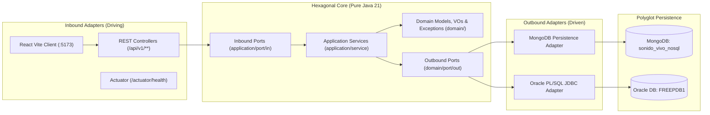

# Sonido Vivo — Software Architecture Overview

- **Project:** `cl.duoc:sonidovivo`
- **Runtime & Stack:** Java 21 LTS · Spring Boot 4.1.2 · Maven
- **Architectural Style:** Hexagonal Modular Monolith (Ports & Adapters)
- **Persistence Strategy:** Polyglot (MongoDB + Oracle Database)
- **Governance & Fitness:** ArchUnit (`archunit-junit5` 1.3.0) + Immutable ADRs (`docs/adr/`)

---

## 1. Architectural Vision: Hexagonal Modular Monolith

Sonido Vivo is an e-commerce and administrative operations platform for professional audio equipment and musical instruments. The backend is structured as a **Hexagonal Modular Monolith** inside the `cl.duoc.sonidovivo` root package:

1. **Domain Purity (`cl.duoc.sonidovivo.domain`)**: Encapsulates business invariants, immutable Value Objects, Domain Models, Domain Exceptions, and Outbound Ports (`domain/port/out`). This layer uses **pure Java 21 only**, with zero dependencies on Spring Framework, Jakarta EE, Jackson, JPA, BSON, or MongoDB drivers.
2. **Application Orchestration (`cl.duoc.sonidovivo.application`)**: Defines Inbound Use Case Ports (`application/port/in`) and Application Services (`application/service`) that coordinate domain logic through Outbound Ports. It depends exclusively on `domain` and standard Java 21 libraries (no Spring Web, JPA, or MongoDB imports).
3. **Infrastructure Adapters & Wiring (`cl.duoc.sonidovivo.infrastructure`)**:
   - **Driving / Inbound Adapters (`adapter/in/rest`)**: REST controllers (`/api/v1/**`), Jakarta Bean Validation DTOs, and `@RestControllerAdvice` exception mapping.
   - **Driven / Outbound Adapters (`adapter/out/persistence`)**: MongoDB adapters (`mongo/`) and Oracle PL/SQL JDBC adapters (`oracle/`).
   - **Configuration & Security (`config/`)**: Manual `@Bean` wiring (`BeanConfig`), CORS policy (`CorsConfig`), and stateless JWT security (`JwtService`, `JwtAuthenticationFilter`, `SecurityConfig`).

See [ADR-0001: Hexagonal Modular Monolith](adr/0001-hexagonal-modular-monolith.md) for trade-offs and evaluated alternatives.

---

## 2. Bounded Contexts

Inside the modular monolith, domain capabilities are organized into four cohesive bounded contexts with strict contract boundaries:

| Bounded Context | Primary Responsibilities | Backing Store / Mechanism | Contract Reference |
| :--- | :--- | :--- | :--- |
| **Catalog & Inventory** | Polymorphic product attributes (`especificaciones`), SKU validation, atomic `$inc` stock adjustments, embedded reviews (`$push`), soft discontinuation (`DESCONTINUADO`), real-time `$aggregate` KPIs, and batch price adjustments. | MongoDB (`sonido_vivo_nosql.productos`) | [CONTRACT_DATABASE_MONGODB.md](contracts/CONTRACT_DATABASE_MONGODB.md) |
| **Customers** | Customer registration, lookup, profile updates, and Chilean RUT/email domain validation. | Oracle / Repository Port | [CONTRACT_FULLSTACK_REST.md](contracts/CONTRACT_FULLSTACK_REST.md) |
| **Sales & Relational Operations** | Transactional sales registration, customer liquidation batches, and discount calculation via PL/SQL package `PKG_SONIDO_VIVO` (`SP_REGISTRAR_VENTA`, `SP_LIQUIDAR_CLIENTES`, `FN_CALCULAR_DESCUENTO`). | Oracle Database (`JdbcTemplate` / `SimpleJdbcCall`) | [BACKEND_DATABASE_INTEGRATION.md](BACKEND_DATABASE_INTEGRATION.md) |
| **Identity & Access Control** | Administrator authentication (`POST /api/v1/auth/login`), BCrypt password verification, stateless HMAC-SHA256 JWT issuance/validation, and `ROLE_ADMIN` route protection. | Spring Security + JJWT `0.12.6` | [CONTRACT_FULLSTACK_REST.md](contracts/CONTRACT_FULLSTACK_REST.md) |

---

## 3. Polyglot Persistence Strategy

Sonido Vivo splits operational workloads across two database engines according to consistency and schema needs:

- **MongoDB (`sonido_vivo_nosql`)**:
  - Configured via `spring.mongodb.uri` (`${MONGO_URI:mongodb://localhost:27017/sonido_vivo_nosql}`) and `spring.data.mongodb.auto-index-creation: true` (Spring Boot 4.x property layout).
  - Enforces server-side `$jsonSchema` structural validation and indexes (`idx_codigo_unique`, `idx_cat_precio`, `idx_tags`, `idx_espec_tipo`).
  - Uses `MongoTemplate` for atomic single-document mutations (`$inc` with `stock_disponible >= quantity` guard, `$push` reviews, `$set` soft deletes) and server-side `$aggregate` pipelines for dashboard KPIs.
- **Oracle Database (`FREEPDB1`)**:
  - Configured via `spring.datasource.*` (`${ORACLE_URL:jdbc:oracle:thin:@localhost:1521/FREEPDB1}`, `${ORACLE_USER:sonido_vivo}`, `${ORACLE_PASS:secret}`, `oracle.jdbc.OracleDriver`) with `spring.jpa.open-in-view: false` and `spring.jpa.hibernate.ddl-auto: none`.
  - Executes ACID transactional PL/SQL stored procedures and functions inside `PKG_SONIDO_VIVO` via Spring JDBC (`JdbcTemplate` / `SimpleJdbcCall`).

See [ADR-0002: Polyglot Persistence with Oracle and MongoDB](adr/0002-polyglot-persistence-oracle-mongo.md) for rationale and consistency boundaries.

---

## 4. Security Architecture

Security follows a **Zero Trust, Stateless Bearer JWT** model configured in `infrastructure/config/`:

- **Authentication**: `POST /api/v1/auth/login` verifies credentials and issues a signed JWT (`io.jsonwebtoken:jjwt-*` `0.12.6`) configured via `app.jwt.secret` (`${JWT_SECRET}`, mandatory in runtime environments with no hardcoded production secret) and `app.jwt.expiration-ms` (`${JWT_EXPIRATION_MS:86400000}`).
- **Authorization**:
  - Public routes: `/api/v1/auth/**` and `/actuator/health`.
  - Protected routes: `/api/v1/admin/**` require an authenticated principal holding `ROLE_ADMIN`.
- **Stateless Session Policy**: `SessionCreationPolicy.STATELESS`, CSRF disabled for pure Bearer-token REST APIs, and explicit CORS allowlist (`http://localhost:5173`, `http://localhost:3000`).
- **Boundary Validation**: Every inbound REST request is validated with `jakarta.validation` annotations on Java `record` DTOs before crossing into Application Services, and domain Value Objects re-enforce invariants inside compact constructors.

See [ADR-0003: Stateless JWT Security](adr/0003-jwt-stateless-security.md) for trade-offs and token lifecycle considerations.

---

## 5. Observability & Runtime Health

- **Spring Boot Actuator**: Exposes `/actuator/health` and `/actuator/info` (`management.endpoints.web.exposure.include: health,info`), with Kubernetes-compatible liveness/readiness probes enabled (`management.endpoint.health.probes.enabled: true`).
- **Least-Privilege Health Details**: `management.endpoint.health.show-details: when-authorized` prevents anonymous callers from inspecting internal database hostnames or pool diagnostics while still returning aggregate `UP`/`DOWN` status on `/actuator/health`.
- **Logging & Traceability Hygiene**:
  - Application logs must never emit credentials, `${JWT_SECRET}`, raw `Authorization: Bearer ...` headers, or unmasked PII.
  - Request correlation (`trace_id` / `span_id` propagation via W3C `traceparent`) and structured JSON logging are the recommended baseline for container/production deployments.

---

## 6. Automated Architectural Governance (Fitness Functions)

Architectural boundaries are verified continuously during `mvnw test` via **ArchUnit (`1.3.0`)** in `src/test/java/cl/duoc/sonidovivo/architecture/HexagonalArchitectureTest.java`:

1. `domain..` must NOT depend on `org.springframework..`, `jakarta..`, `org.bson..`, `com.mongodb..`, `oracle..`, `..application..`, or `..infrastructure..`.
2. `application..` must NOT depend on `..infrastructure..` or `org.springframework.web..`.
3. Inbound REST controllers in `infrastructure..` must reside under `..adapter.in.rest..`.

Offline test execution is configured in `src/test/resources/application.yaml` by excluding DataSource, JPA, and MongoDB auto-configurations so pure unit and ArchUnit fitness tests run deterministically without live Oracle or MongoDB servers.
